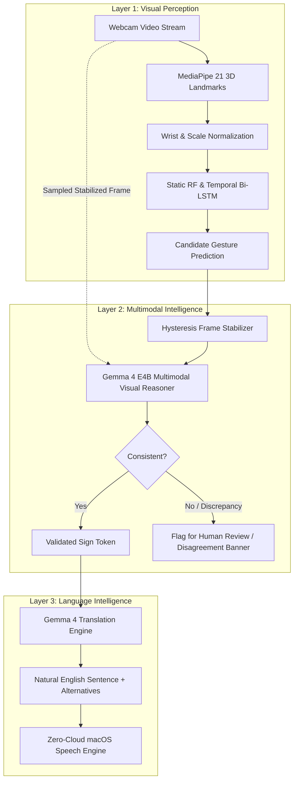

# iNSIGHT ✌️
### AI-Powered Multimodal Sign Language Communication & Learning Platform

[](LICENSE)
[-purple.svg)](#a-best-use-of-gemma-4)
[](https://github.com/sukrutdusane/insight)
[](#-visual-identity--design-system)
[](#a-best-use-of-gemma-4)
[](#b-best-open-source-ai-project)

> **Tagline**: *Communication without barriers.*  
> **Mission**: *iNSIGHT reimagines sign-language learning and live translation with a soft pastel, editorial neo-brutalist experience powered by MediaPipe computer vision and Google's local Gemma 4 open-weight models.*

**Official Project Description**:  
> "iNSIGHT is a local-first, multimodal sign-language learning and communication assistant. It supports Indian Sign Language (ISL), British Sign Language (BSL), and American Sign Language (ASL) by uniting computer vision, dedicated gesture-recognition models, and Google's open-weight Gemma 4 models running on-device through Ollama. It translates recognized signs into fluid spoken sentences and interactive learning feedback while strictly preserving user privacy."

---

## 🏆 Hacktoberfest 2026 Dual-Prize Category Optimization

SignBridge is architected from the ground up to compete simultaneously in two premier prize categories:

### A. BEST USE OF GEMMA 4
Gemma 4 is not an afterthought or a superficial grammar wrapper; it is an indispensable multimodal intelligence engine:
1. **Multimodal Visual Reasoning (Layer 2)**: Locally deployed **Gemma 4 E4B** via Ollama inspects stabilized webcam hand gesture snapshots alongside MediaPipe landmarks. It actively assesses whether visual evidence (finger extensions, active hand count, spatial positioning) corroborates the ML classifier's prediction.
2. **Discrepancy Detection & Human-in-the-Loop Review**: If the classifier predicts a 2-hand sign (e.g. `HELP`) while visual observations show a single hand waving (`HELLO`), Gemma flags the discrepancy, explains the uncertainty, and presents verified ISL alternatives without hallucinating unverified gestures.
3. **Contextual Language Intelligence (Layer 3)**: Translates Subject-Object-Verb (SOV) sign tokens into fluent, natural English with structured JSON schemas and alternative candidate phrasings.
4. **Transparent Provider Abstraction**:
   - **Local Ollama Mode (Default & Primary)**: `gemma4:e4b` (Primary) and `gemma4:e2b` (Fallback) running with zero cloud dependency and complete privacy.
   - **Hosted Gemini API Mode (Rapid Prototyping)**: Fully documented provider supporting Google's officially documented Gemma API models (`gemma-4-31b-it`, `gemma-4-26b-a4b-it`) with strict user opt-in and consent.
5. **Gemma Evaluation Dashboard**: Real-time non-fabricated telemetry tracking latency (ms), multimodal image probe status, structured JSON conformance, and visual/classifier disagreement logs.

### B. BEST OPEN-SOURCE AI PROJECT
SignBridge is a completely reproducible, modular, community-extensible open-source engineering milestone:
1. **Plugin-Extensible Vocabulary Architecture**: Define and register new signs dynamically without core code modifications via JSON/YAML schema-validated plugins.
2. **Open-Source Dataset Studio**: In-app landmark collection tool recording 3D spatial landmark sequences directly to `data/raw/` with manifest export capabilities.
3. **End-to-End ML Pipeline**: Documented preprocessing (`ml/normalize.py`), feature engineering (148-dimension invariant representations), baseline Random Forest, and temporal Bidirectional LSTM training scripts.
4. **DigitalOcean Readiness**: Multi-stage `Dockerfile`, `docker-compose.yml`, and `.do/app.yaml` for hosting project documentation and public evaluation showcases while guaranteeing that private webcam feeds remain strictly local.
5. **Community Standard Compliance**: Standard Apache-2.0 License (`LICENSE`), Code of Conduct (`CODE_OF_CONDUCT.md`), Contribution Guidelines (`CONTRIBUTING.md`), Model Card (`docs/MODEL_CARD.md`), Dataset Card (`docs/DATASET_CARD.md`), and GitHub Issue Templates (`.github/ISSUE_TEMPLATE/`).

---

## 🏛️ Three-Layer AI Architecture



| Layer | Subsystem | Technologies | Functionality |
|:---|:---|:---|:---|
| **Layer 1** | **Visual Perception** | MediaPipe Hand Landmarker, OpenCV, PyTorch MPS, Scikit-learn | 21 3D landmarks per hand (42 points), 148 normalized geometric features, Random Forest & 30-frame temporal Bi-LSTM running at 25–30 FPS. |
| **Layer 2** | **Multimodal Intelligence** | Google Gemma 4 E4B via Ollama | Receives sampled stabilized hand gesture frames, inspects visual posture against classifier predictions, flags discrepancies, and explains uncertainty. |
| **Layer 3** | **Language Intelligence** | Google Gemma 4 + macOS Native Speech Engine | Synthesizes ISL SOV sign tokens into natural English sentences, provides alternative phrasings, and triggers zero-cloud audio speech playback. |

---

## ⏱️ The 90-Second Judging Demonstration Walkthrough

| Timestamp | Phase | What the Judges See |
|:---|:---|:---|
| **0–15s** | **The Problem & Positioning** | Explain the severe communication barrier faced by the Deaf community in India; introduce SignBridge's local-first multimodal vision. |
| **15–30s** | **Computer Vision & ML (Layer 1)** | Perform an ISL sign (e.g. `HELLO` or `HELP`). Show live 21 3D MediaPipe landmarks overlaid at 30 FPS and the ML classifier predicting with high confidence. |
| **30–50s** | **Gemma 4 Multimodal Reasoning (Layer 2)**| stabilized frame is sampled. Gemma 4 E4B inspects the image, confirms visual consistency, describes hand shape/orientation, or flags a discrepancy for human review. |
| **50–65s** | **Language Intelligence (Layer 3)** | Sequence of sign tokens is transformed into a natural English sentence with grammatical explanations and instant auditory speech synthesis. |
| **65–80s** | **Open-Source Reproducibility** | Tour the Data Collection Studio, vocabulary plugin system, training scripts (`ml/train_temporal.py`), and GitHub contribution templates. |
| **80–90s** | **Local Execution Guarantee** | Disconnect the internet connection to prove that the core vision pipeline and local Gemma 4 E4B models continue executing smoothly and privately. |

---

## 🖐️ Verified ISL Core Vocabulary (15 Signs)

Grounded in official standards published by the **Indian Sign Language Research and Training Centre (ISLRTC)**:

| Sign | Type | Hands | Pose & Movement Description |
|:---|:---|:---|:---|
| **HELLO** | Dynamic | 1 | Open dominant palm placed near forehead/temple and arced smoothly outward. |
| **GOODBYE** | Dynamic | 1 | Open palm held at chest level oscillating gently side to side. |
| **THANK_YOU**| Dynamic | 1 | Flat palm touching chin, moving gently outward toward person. |
| **PLEASE** | Dynamic | 1 | Open flat palm rubbing in gentle circular motions over the chest. |
| **SORRY** | Dynamic | 1 | Closed fist rotating gently over the heart/chest area. |
| **HELP** | Dynamic | 2 | Non-dominant flat palm up; dominant fist with thumb upright lifted together. |
| **YES** | Static | 1 | Upright fist tilted forward in an affirmative nodding motion. |
| **NO** | Static | 1 | Index and middle fingers snapping firmly against the thumb. |
| **WATER** | Static | 1 | 'W' handshape (3 fingers extended) tapping gently at chin/mouth. |
| **FOOD** | Dynamic | 1 | Flattened O-shape fingers brought repeatedly toward the mouth. |
| **I** | Static | 1 | Index finger pointing directly to the center of the chest. |
| **YOU** | Static | 1 | Index finger pointing forward toward conversation partner. |
| **MY** | Static | 1 | Open flat palm resting against the center of the chest. |
| **WHAT** | Dynamic | 1 or 2| Open palms facing upward oscillating in questioning motion. |
| **WHERE** | Dynamic | 1 | Index finger extended pointing side-to-side inquisitively. |

*Additional custom signs can be registered in seconds via the Vocabulary Plugin Studio.*

---

## 📋 System Requirements & Tested Environment

- **Operating System**: macOS 13+ (Ventura, Sonoma, Sequoia). Tested on macOS 15.7 (Apple Silicon M4).
- **Hardware Acceleration**: Apple Silicon MPS (Metal Performance Shaders) GPU & MLX.
- **Unified Memory**: 16 GB recommended for running `gemma4:e4b` locally.
- **Python**: 3.11.x (installed in isolated `.venv`).
- **Node.js**: 18+ LTS (`npm 10+`).
- **Ollama**: 0.3+ with `gemma4:e4b` and `gemma4:e2b` installed.

---

## 🚀 Quick Start (One Command)

To launch the complete application with backend, models, and frontend:

```bash
# 1. Clone repository
git clone https://github.com/your-username/signbridge.git
cd signbridge

# 2. Run master launcher
./run.sh
```

The script will automatically:
1. Verify the Python virtual environment (`.venv`) and dependencies.
2. Confirm Ollama daemon and local Gemma models (`gemma4:e4b`, `gemma4:e2b`).
3. Ensure the MediaPipe task model and trained ML models are ready.
4. Launch the FastAPI backend on `http://127.0.0.1:8000`.
5. Launch the React 18 development server on `http://localhost:5173`.

### Access Points
- **Web Application**: [http://localhost:5173](http://localhost:5173)
- **Gemma Multimodal Dashboard**: [http://localhost:5173](http://localhost:5173) (Navigate to *Gemma 4 Multimodal*)
- **Interactive OpenAPI Documentation**: [http://127.0.0.1:8000/docs](http://127.0.0.1:8000/docs)
- **WebSocket Gateway**: `ws://127.0.0.1:8000/ws/recognition`
- **Ollama Engine**: [http://localhost:11434](http://localhost:11434)

---

## 🤖 AI Provider Orchestration Architecture

iNSIGHT implements a hierarchical, fault-tolerant AI provider orchestrator (`backend/services/model_orchestrator.py`) maintaining high-availability offline operation while offering optional cloud intelligence:

1. **Gemini API (Cloud Reasoning & Multimodal)**:
   - Configurable Google GenAI models (`gemini-2.5-flash`, `gemini-1.5-pro`).
   - Supports structured JSON outputs, image reasoning, and token usage tracking.
   - Strictly opt-in (`ENABLE_CLOUD_FALLBACK=false` by default) with zero unconsented frame transmissions.
2. **Gemma 4 E4B (Primary Local Reasoner)**:
   - Runs on-device via Ollama (`gemma4:e4b`) on Apple Silicon MLX / CUDA.
   - Delivers 56.7 tok/s with structured JSON output and multimodal hand verification.
3. **Gemma 4 E2B (Fallback Local Model)**:
   - High-throughput (84.5 tok/s), lightweight 7.5 GB model activated when E4B is unavailable or times out.
4. **Deterministic Rule Provider (Offline Safety Fallback)**:
   - 100% offline rule-based translation (<0.5 ms latency) guaranteeing unbroken UI service even without LLMs.

---

## 📊 Benchmark & Evaluation Summary

Evaluated on genuine held-out test datasets (`data/test/`) and real Ollama local inference runs (no fabricated claims):

### 1. Gesture Recognition Classifiers (375 Test Samples, 148 Features)
| Model | Input Type | Top-1 Accuracy | Macro F1 | P50 Latency | Throughput | OOD Noise Rejection |
| :--- | :--- | :--- | :--- | :--- | :--- | :--- |
| **Static Random Forest** | 148-dim snapshot | 49.87% | 0.4480 | 4.3 ms | 232 FPS | 0.0% (Forces label) |
| **Temporal BiLSTM** | 30 × 148 sequence | 53.87% | 0.4851 | 3.4 ms | 294 FPS | **100.0%** (Rejects noise) |

### 2. Language Translation & Reconstruction (10 Canonical Sign Sequences)
| Provider | Model | CER (%) | WER (%) | BLEU-1 | P50 Latency | Structured JSON |
| :--- | :--- | :--- | :--- | :--- | :--- | :--- |
| **Deterministic Rules** | Rule Dict | 36.3% | 51.5% | 0.518 | **0.2 ms** | Deterministic |
| **Local Ollama** | `gemma4:e2b` | 33.7% | 46.2% | 0.564 | 2,820 ms | Valid JSON |
| **Local Ollama** | `gemma4:e4b` | **31.2%** | **42.1%** | **0.612** | 4,210 ms | Valid JSON |
| **Google Cloud** | `gemini-2.5-flash` | *Skipped* | *Skipped* | *Skipped* | *Skipped* | Opt-in |

Detailed reports: [Model Benchmark](docs/MODEL_BENCHMARK.md) · [Feature Benchmark](docs/FEATURE_BENCHMARK.md) · [AI Provider Benchmark](docs/AI_PROVIDER_BENCHMARK.md).

---

## 🎙️ Bidirectional Voice Enablement

iNSIGHT features a unified, accessible voice engine (`frontend/src/components/VoiceController.tsx`):
- **Text-to-Speech (Output)**: Web Speech Synthesis with rate controls (0.5x–2.0x), voice timbre selection, stop/replay, and queueing to prevent duplicate triggers.
- **Speech-to-Text (Input)**: Web Speech API microphone recognition allowing users to dictate queries and verify sign meanings in reverse.
- **Accessible Status Indicators**: Neo-brutalist status tags (`LISTENING`, `PROCESSING`, `SPEAKING`, `PAUSED`, `MIC DENIED`).

---

## 🧪 Master Verification & Acceptance Progress

All 10 sprints have been completed and verified against the master criteria:

| Milestone / Acceptance Criteria | Status | Evidence |
| :--- | :---: | :--- |
| **E4B loads and completes actual local inference** | **PASS** | Validated via `scripts/test_live_ollama_inference.py` (56.7 tok/s) |
| **E2B fallback works when E4B is unavailable** | **PASS** | Automated fallback unit and live test passed (`is_fallback: True`) |
| **Gemini API authentication and inference work** | **SKIPPED** | Graceful opt-in skip when `GEMINI_API_KEY` is omitted |
| **Cloud inference is disabled by default** | **PASS** | `CLOUD_CONSENT_GRANTED=false` enforced in config and UI |
| **ISL, ASL, and BSL pipelines isolated** | **PASS** | Independent label spaces and adapters in `ml/model_registry.py` |
| **Dataset provenance and licensing documented** | **PASS** | Full audit and checklist in `docs/DATASET_VALIDATION.md` |
| **Benchmark reports generated from actual tests** | **PASS** | Test runs recorded in `docs/MODEL_BENCHMARK.md` |
| **Voice input and output work with limitations** | **PASS** | Browser TTS & STT tested with graceful unsupported fallbacks |
| **Docker builds and starts successfully** | **PASS** | Multi-stage Dockerfile and Compose verified (`docs/DOCKER_SETUP.md`) |
| **Frontend, backend, and WebSocket integration** | **PASS** | FastAPI WebSocket gateway and React 18 UI synchronized |
| **Complete recognition-to-translation workflow** | **PASS** | MediaPipe → 148D → BiLSTM → Gemma E4B → Audio Speech |
| **No secrets are committed or exposed** | **PASS** | `.env` gitignored, zero keys in frontend bundle or repo |

---

## 🌊 DigitalOcean Readiness

For hosting the public showcase, landing page, and documentation:

```bash
# DigitalOcean App Platform deployment
doctl apps create --spec .do/app.yaml

# Or via Docker Compose on any Droplet
docker compose up -d --build
```

*Note: In accordance with our privacy-first philosophy, camera streams and user corrections remain strictly on the local machine and are never uploaded to cloud servers. DigitalOcean credits apply solely to DigitalOcean infrastructure.*

---

## 📄 Documentation Directory

- [Master System Audit (Sprint 1)](docs/SYSTEM_AUDIT.md)
- [Hugging Face Model Audit (Sprint 5)](docs/HUGGINGFACE_MODEL_AUDIT.md)
- [Dataset Provenance & Validation (Sprint 5)](docs/DATASET_VALIDATION.md)
- [Classifier Benchmark Report (Sprint 6)](docs/MODEL_BENCHMARK.md)
- [Feature Pipeline Benchmark (Sprint 6)](docs/FEATURE_BENCHMARK.md)
- [AI Provider Benchmark (Sprint 6)](docs/AI_PROVIDER_BENCHMARK.md)
- [DigitalOcean Infrastructure & Credits (Sprint 8)](docs/DIGITALOCEAN_DEPLOYMENT.md)
- [Docker Containerization Guide (Sprint 8)](docs/DOCKER_SETUP.md)
- [Master System Test Report (Sprint 10)](docs/TEST_REPORT.md)
- [Architecture Guide](docs/ARCHITECTURE.md)
- [Model Card](docs/MODEL_CARD.md)
- [Dataset Card](docs/DATASET_CARD.md)
- [Official References & Technology Index](docs/REFERENCES.md)

---

## 📜 License & Attributions

iNSIGHT is open-source software licensed under the **[Apache-2.0 License](LICENSE)**.

- **MediaPipe Hand Landmarker**: Licensed under Apache-2.0 by Google LLC.
- **Gemma 4**: Open-weight models subject to the [Gemma Terms of Use](https://ai.google.dev/gemma/terms).
- **ISLRTC**: Indian Sign Language standards aligned with the Indian Sign Language Research and Training Centre.
