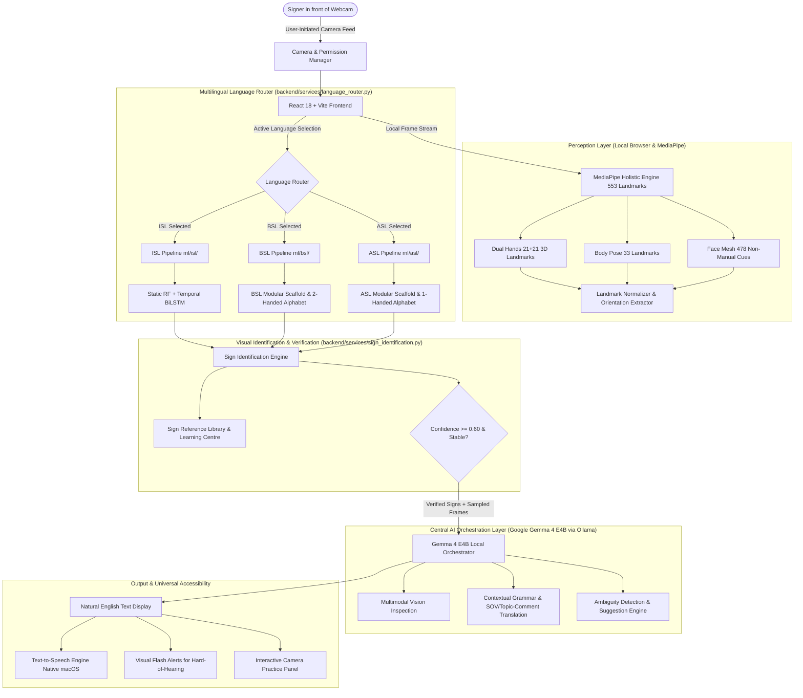

# SignBridge 2.0 — Multilingual Sign Language Intelligence Architecture

SignBridge 2.0 is a local-first, multilingual sign language recognition, visual identification, and translation intelligence platform. It coordinates computer vision, dedicated language-specific recognition models, and **Google Gemma 4 E4B** running locally through Ollama across three sign languages:
- **ISL** (Indian Sign Language)
- **BSL** (British Sign Language)
- **ASL** (American Sign Language)

---

## 1. System Architecture Overview



---

## 2. Core Architectural Principles

### 1. Division of Responsibility: Recognition vs. Orchestration
- **Specialist Gesture Models**: Dedicated, language-specific classifiers trained on authentic sign-language datasets (`ml/isl/`, `ml/bsl/`, `ml/asl/`) identify raw gesture configurations.
- **Gemma 4 E4B Orchestrator**: Operates on verified classifier predictions, visual evidence frames, and language grammars. Gemma refines natural language, detects sequence ambiguity, and validates hand posture, but **never invents unverified signs**.

### 2. Strict Multilingual Independence
- A sign in ASL does **not** equal a sign in BSL or ISL.
- Distinct manual alphabets:
  - **ASL**: One-handed fingerspelling (French Sign Language lineage).
  - **BSL**: Two-handed fingerspelling (BANZSL family, vowels on non-dominant fingertips).
  - **ISL**: Two-handed hybrid system with distinct consonant touch points and grammatical SOV structure.
- The router (`backend/services/language_router.py`) strictly enforces isolation and never silently substitutes one language classifier for another.

### 3. MediaPipe Holistic Upgrade (553 Landmarks)
- **Face (478 points)**: Extracts non-manual grammatical cues (head tilt, eyebrow raise/furrow, mouth shape) without emotional stereotyping or privacy invasion.
- **Body Pose (33 points)**: Tracks shoulders, elbows, and wrist-to-body spatial relationships essential for signs executed near the chest, chin, or forehead.
- **Hands (21 + 21 points)**: Full 3D articulation, palm orientation vectors, and finger extension tracking.

### 4. User-Controlled Camera Permissions & Zero Cloud Leaks
- Camera does not start automatically on page load. An explicit user interaction triggers the `useCamera` hook and `<CameraPermissionDialog>`.
- All video frame processing is strictly local to the client browser and local Python backend (`localhost`).

---

## 3. Directory Layout

```
sign_language_identifier/
├── backend/
│   ├── api/routes/
│   │   ├── languages.py          # Multilingual selection and vocabulary routes
│   │   ├── translation.py        # Sequence orchestration & sign identification
│   │   ├── gemma.py              # Gemma evaluation & multimodal inspection
│   │   └── websocket.py          # Real-time WebSocket frame stream
│   ├── services/
│   │   ├── language_router.py    # Language selection, isolation & routing
│   │   ├── gemma_orchestrator.py # Local Gemma 4 E4B multimodal orchestrator
│   │   ├── sign_identification.py# Sign reference matching & uncertainty tracking
│   │   ├── translation_orchestrator.py # End-to-end translation pipeline
│   │   └── gesture_service.py    # Frame predictor and smoothing bridge
├── config/
│   └── languages/
│       ├── isl.json              # Indian Sign Language config, vocab & alphabet
│       ├── bsl.json              # British Sign Language config, vocab & alphabet
│       └── asl.json              # American Sign Language config, vocab & alphabet
├── ml/
│   ├── isl/                      # ISL recognition pipeline
│   ├── bsl/                      # BSL recognition pipeline
│   └── asl/                      # ASL recognition pipeline
├── docs/
│   ├── ARCHITECTURE.md           # System specification
│   ├── DATASET_COVERAGE.md       # Dataset licensing, diversity & splits
│   └── GEMMA4_MULTIMODAL.md      # Multimodal Ollama vision integration guide
└── frontend/src/
    ├── components/
    │   ├── CameraPermissionDialog.tsx # User-initiated permission dialog
    │   ├── SignLanguageSelector.tsx   # ISL / BSL / ASL switcher
    │   ├── SignIllustration.tsx       # SVG vector diagram with movement arrows
    │   ├── SignReferenceCard.tsx      # Sign reference card with mechanics
    │   └── SignPracticePanel.tsx      # Interactive camera practice panel
    ├── hooks/
    │   └── useCamera.ts               # Controlled camera stream hook
    ├── pages/
    │   ├── LiveTranslator.tsx         # Multilingual live translator
    │   ├── SignDictionary.tsx         # Reference library & fingerspelling
    │   ├── SignLearningCentre.tsx     # Learning centre & visual identification
    │   └── AccessibilitySettingsPage.tsx # Inclusive design controls
    └── services/
        └── mediapipe/                 # Holistic, pose, face, normalizer, monitor
```
