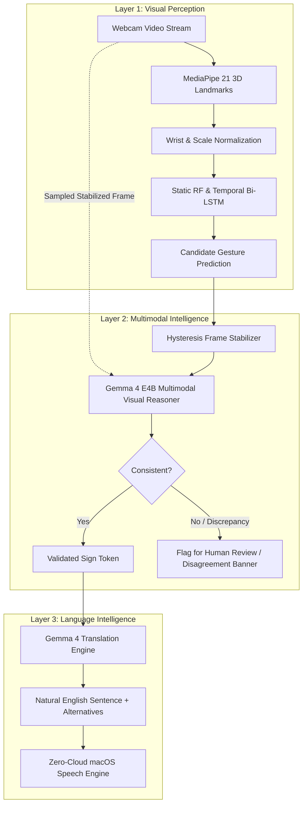

# Gemma 4 Multimodal Visual Reasoning & Language Intelligence 🧠
### Architectural Deep Dive • Hacktoberfest 2026 Target: Best Use of Gemma 4

---

## 1. Executive Summary

SignBridge transforms Google's open-weight **Gemma 4** from an optional post-hoc grammar corrector into a **core multimodal intelligence engine**.

Rather than solely feeding recognized text tokens into an LLM, SignBridge implements a **three-layer AI architecture** where Gemma 4 actively cross-evaluates live computer vision observations, validates predicted Indian Sign Language (ISL) gestures against physical hand posture images, explains recognition uncertainty, and refines grammar into natural sentences.

---

## 2. Three-Layer Subsystem Architecture

### Layer 1 · Visual Perception (MediaPipe + Specialized ML)
- High-frequency live tracking running at **25–30 FPS**.
- MediaPipe Hand Landmarker extracts 42 coordinates (21 per hand).
- Specialized models handle domain-specific gesture patterns:
  - **Random Forest**: Instant single-frame static poses (*YES, NO, WATER, I, YOU, MY*).
  - **Temporal Bi-LSTM**: 30-frame temporal motion gestures (*HELLO, GOODBYE, THANK_YOU, PLEASE, SORRY, HELP, FOOD, WHAT, WHERE*).
- Hysteresis smoothing prevents flickering.

### Layer 2 · Multimodal Intelligence (Gemma 4 E4B Visual Reasoning)
- **Controlled Frame Sampling**: Instead of overwhelming the local GPU by sending every raw 30 FPS webcam frame to the LLM, the system samples a selected high-resolution snapshot once a gesture stabilizes.
- **Multimodal Prompting**: Gemma 4 receives:
  1. The selected hand gesture image (base64 encoded).
  2. The classifier's predicted sign label and confidence.
  3. Detected hand count (single-hand vs. dual-hand).
  4. Geometric landmark cues (finger flexions, palm orientation).
- **Cross-Verification Protocol**:
  - Compares visual evidence (number of hands, finger extension, palm vector) against ISLRTC standards.
  - Detects discrepancies: e.g., if the classifier predicted `HELP` (which requires 2 hands), but visual observations show only a single hand waving (`HELLO`), Gemma flags a discrepancy.
  - Suggests alternatives strictly from the verified vocabulary.
  - **Non-Hallucination Invariant**: Gemma is strictly prohibited from inventing unverified ISL signs.

### Layer 3 · Language Intelligence (Gemma 4 Translation Engine)
- Translates recognized ISL sign sequences (which follow Subject-Object-Verb / SOV structure without copulas) into natural English sentences.
- Produces structured JSON output with:
  - `sentence`: Refined natural English.
  - `alternatives`: Context-aware phrasing options.
  - `notes`: Grammatical reasoning explanation (e.g. SOV to SVO adjustment).

---

## 3. Local Execution vs. Optional Hosted Gemini API

SignBridge provides a clear, transparent provider abstraction:

| Property | Local Ollama Mode (Default) | Hosted Gemini API Mode (Rapid Prototyping) |
|:---|:---|:---|
| **Primary Model** | `gemma4:e4b` (4B Multimodal) | `gemma-4-31b-it` / `gemma-4-26b-a4b-it` |
| **Fallback Model**| `gemma4:e2b` (2B Lightweight) | `gemma-4-26b-a4b-it` |
| **Internet Dependency**| **100% Offline (Zero Cloud)** | **Requires Active Internet Connection** |
| **Privacy Guarantee** | Camera frames never leave local RAM | Frames sent to Google endpoint with explicit consent |
| **Hardware Required**| Apple Silicon (Metal/MPS) or GPU | Any workstation with API key |
| **Activation** | Default out-of-the-box | Opt-in toggle in UI with user API key + consent checkbox |

---

## 4. Disagreement Handling & Human-in-the-Loop Review

When Layer 1 (specialized classifier) and Layer 2 (Gemma 4 visual reasoning) disagree:
1. The prediction is **never silently overwritten**.
2. A prominent **Disagreement Alert Banner** appears on the UI.
3. The event is recorded in the local audit log with timestamps, confidence scores, and visual observation notes.
4. The user can:
   - **Confirm Classifier Prediction**: If the physical sign was correct despite partial occlusion.
   - **Accept Gemma Suggestion**: If visual reasoning correctly identified a misclassification.
   - **Submit Manual Correction**: Recorded into the local SQLite feedback queue for offline retraining.

---

## 5. Gemma Evaluation Dashboard & Telemetry

The application features a dedicated **Gemma Dashboard** (`http://localhost:5173`) providing live, non-fabricated telemetry:
- Active provider and model tag.
- Multimodal capability probe status.
- Measured average inference latency (in milliseconds).
- Disagreement event audit log.
- Side-by-side benchmark comparison between `gemma4:e4b`, `gemma4:e2b`, and hosted endpoints.
